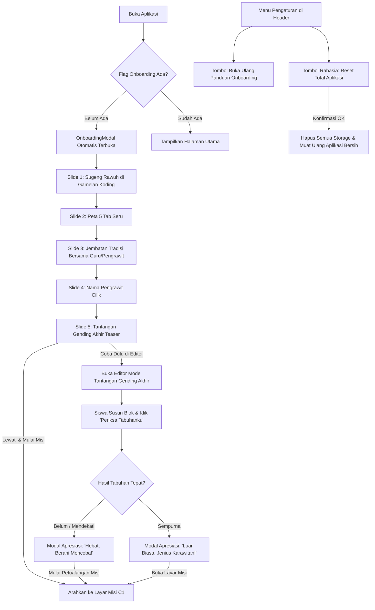

# Gamelan Koding — Milestone 6: Onboarding + Tantangan Gending Akhir + Reset Data Total

**Status:** Approved by User  
**Date:** 2026-10-18  
**Scope:** Milestone 6 dari `PRD_Gamelan_Koding.md` (Bagian 4.1 & 11)  

---

## 1. Latar Belakang & Tujuan
Milestone 6 bertujuan menyambut siswa baru saat pertama kali membuka aplikasi Gamelan Koding, mengenalkan konteks budaya musik karawitan dan logika pemrograman visual, menanyakan nama panggilan siswa, serta memberikan "Tantangan Gending Akhir" sebagai penguji rasa ingin tahu (*curiosity-driven challenge*) sebelum melangkah ke misi bertingkat Taksonomi Bloom (C1–C6).

Selain itu, ditambahkan fitur **Reset Data Total Aplikasi** di dalam menu Pengaturan/Profil Siswa agar pengembang, juri, guru, atau pengguna dapat menghapus seluruh memori/localStorage peramban dan mengembalikan aplikasi ke kondisi awal bersih (*clean slate*) persis seperti pertama kali dibuka.

---

## 2. Alur Pengguna (User Flow)

---

## 3. Spesifikasi Komponen & Antarmuka

### 3.1 Modal Onboarding (`src/components/onboarding/OnboardingModal.tsx`)
Modal interaktif beranimasi halus, responsif (portrait touch target minimal 44px), dengan 5 slide terstruktur:

1. **Slide 1 — Sugeng Rawuh**:
   - Ikon/ilustrasi gamelan bercahaya.
   - Penjelasan: belajar logika koding drag & drop berakar pada keindahan gamelan Jawa laras slendro.
2. **Slide 2 — Peta 5 Tab**:
   - Menjelaskan fungsi Beranda, Belajar, Editor Blok, Misi C1–C6, dan Karyaku.
3. **Slide 3 — Jembatan Tradisi Bersama Guru/Pengrawit**:
   - Nilai budaya: aplikasi ini adalah jembatan menuju alat musik gamelan fisik di sanggar/sekolah dan pendampingan bapak/ibu guru pengrawit.
4. **Slide 4 — Nama Pengrawit Cilik**:
   - Input nama panggilan (default: "Pengrawit Cilik").
   - Disimpan ke `localStorage` dengan key `gamelan_student_name`.
5. **Slide 5 — Tantangan Gending Akhir**:
   - Penjelasan tantangan: *"Sebelum memulai petualangan dari dasar, bisakah kamu menebak dan meniru pola gending penutup ini?"*
   - Pola Target: **Lancaran 8 Ketukan** (`3 - 5 - 3 - 2 - 3 - 5 - 6 - 5` + Gong Ageng di ketukan ke-8 seleh).
   - Label Integritas Budaya: `"Contoh — belum divalidasi praktisi karawitan"` (`validatedBy: null`).
   - Tombol audio: **"Dengarkan Pola Target"** (memutar audio via `digitalSimOutput` / `gamelanSynth`).
   - Dua tombol aksi:
     - **"Coba Dulu di Editor"**: Menyimpan flag onboarding selesai, lalu mengarahkan ke Editor dalam mode Tantangan Gending Akhir.
     - **"Lewati & Mulai Misi (C1)"**: Menyimpan flag onboarding selesai, lalu langsung mengarahkan ke Misi C1.

### 3.2 Mode Tantangan Gending Akhir di Editor
- `EditorPage` menerima prop `isFinalChallengeActive: boolean` dan callback `onExitFinalChallenge: () => void`.
- Menampilkan banner khusus warna kuning-oranye di atas kanvas koding:
  - Judul: *"Tantangan Awal: Gending Akhir"*
  - Target: *"Pola Lancaran 8 Ketukan (3 - 5 - 3 - 2 - 3 - 5 - 6 - 5 + Gong)"*
  - Tombol **"Dengarkan Target"**
  - Tombol **"Periksa Tabuhanku"**
  - Tombol **"Keluar Tantangan"**
- Evaluator otomatis membandingkan event blok siswa terhadap target 8 ketukan saron dan gong seleh.
- **Umpan Balik Menguatkan (Zero kata "gagal")**:
  - Judul: *"Hebat, Kamu Sudah Berani Mencoba! 👏"*
  - Pesan: *"Tantangan ini memang sengaja dirancang untuk tingkat akhir setelah kamu menguasai semua jenis tabuhan. Jangan berkecil hati, yuk kita mulai dari level dasar (Misi C1) agar kamu bisa mahir selangkah demi selangkah!"*
  - Tombol aksi: *"Mulai Petualangan Misi (C1)"*.

### 3.3 Fitur Reset Total Aplikasi (`src/components/layout/AppHeader.tsx`)
Di dalam modal Pengaturan/Profil Siswa:
1. Tombol **"Lihat Panduan Onboarding"** untuk membuka kembali Onboarding kapan saja.
2. Tombol **"Reset Total Aplikasi (Clean Slate)"** dengan ikon peringatan lembut:
   - Menghapus:
     - `gamelan_student_name`
     - `gamelan_onboarding_completed`
     - `gamelan_mission_progress`
     - `gamelan_karyaku`
     - `gamelan_editor_draft_xml`
   - Membersihkan memori cache internal pada `karyakuService` dan `missionProgressService`.
   - Menampilkan konfirmasi ramah anak sebelum eksekusi.
   - Setelah konfirmasi, me-reload halaman atau mengatur ulang state sehingga aplikasi langsung membuka Onboarding dalam keadaan bersih total.

---

## 4. Persistensi & Error Handling
- Flag onboarding: `localStorage.getItem('gamelan_onboarding_completed') === 'true'`.
- Seluruh akses `localStorage` dibungkus aman dalam `try / catch` sehingga tidak pernah menimbulkan fatal crash jika peramban berada dalam mode pembatasan cookie/storage (misal Safari Private Browsing).

---

## 5. Rencana Pengujian
- Unit test komponen & layanan:
  - Memvalidasi pembacaan/penyimpanan flag onboarding.
  - Memvalidasi fungsi reset total membersihkan seluruh key `gamelan_*`.
  - Memvalidasi evaluasi tabuhan tantangan gending akhir.
- Build test: `npm run build` dan `vitest run` harus lulus 100%.
